# Rust Blender

A Blender-style 3D editor written in Rust. You can drive it with the mouse and keyboard like Blender, by typing plain English, or by speaking. **Everything runs on your machine.** An **Ollama** language model plans the edits and **OpenAI Whisper**, running in pure Rust through `candle`, turns your speech into text.

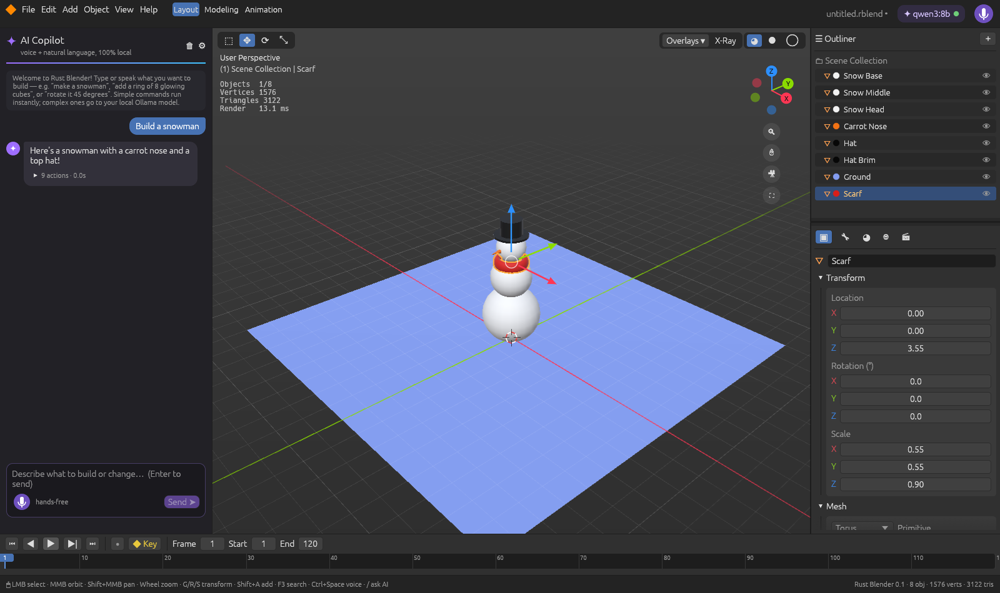

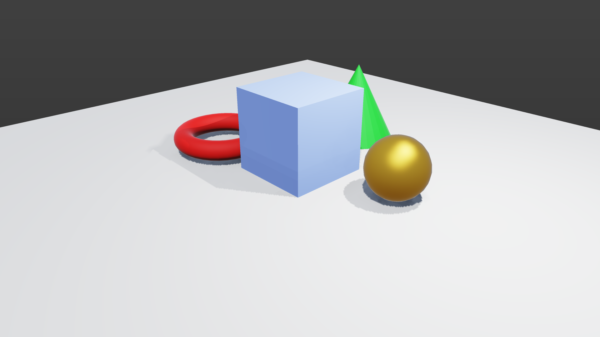

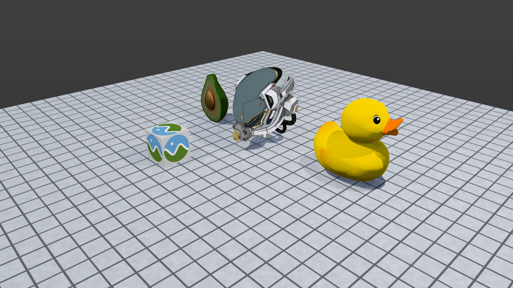

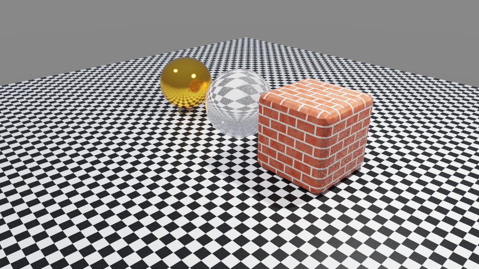

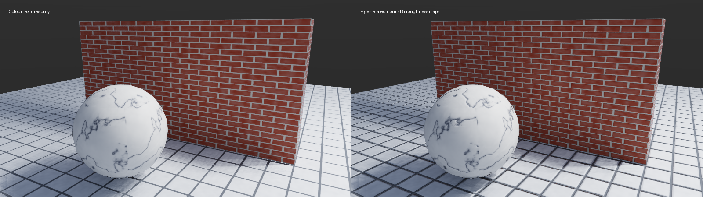

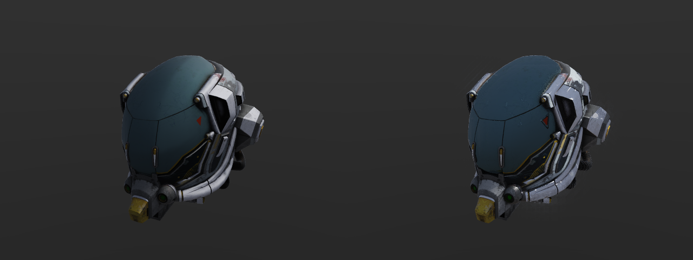

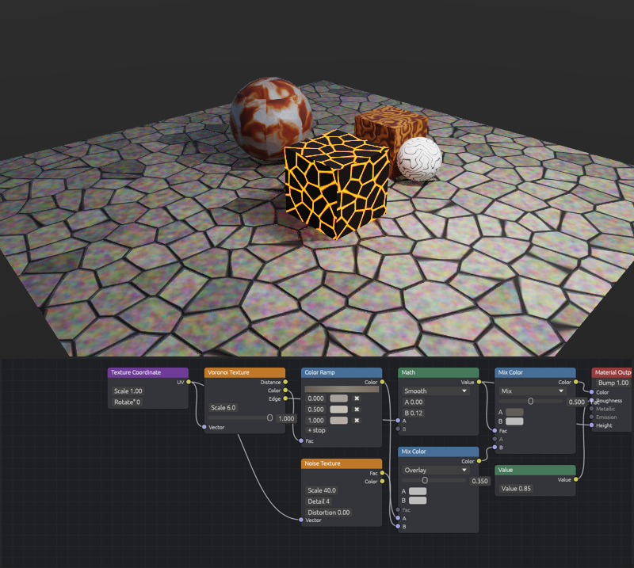
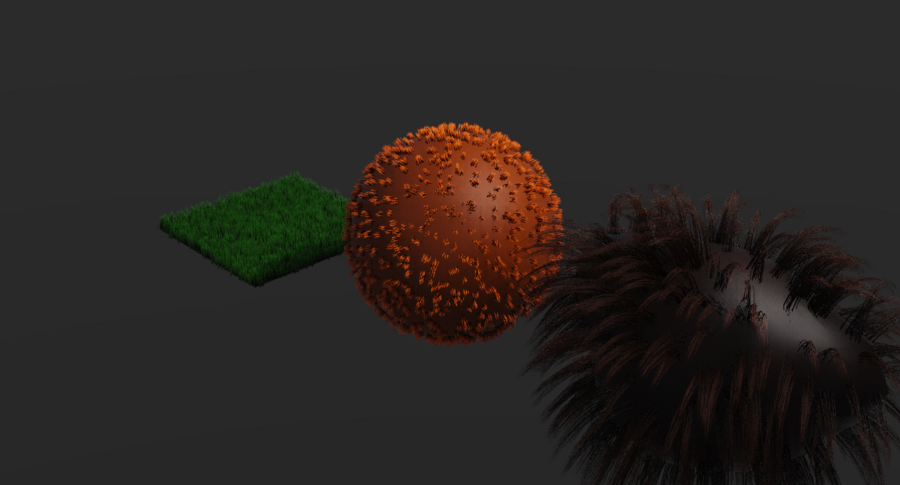
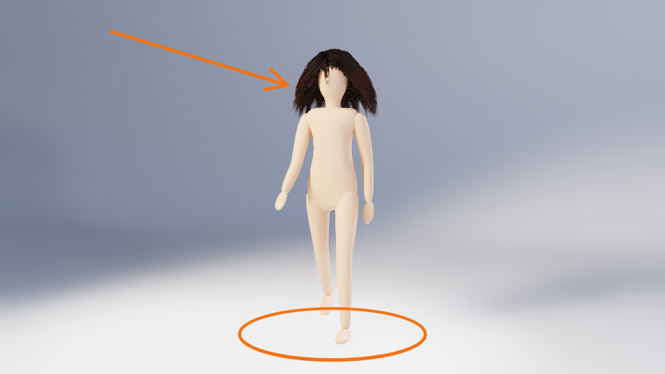
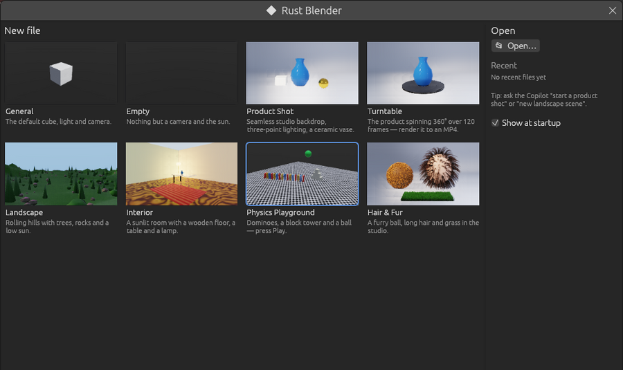 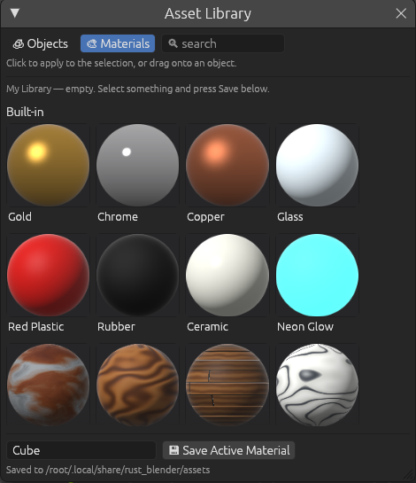

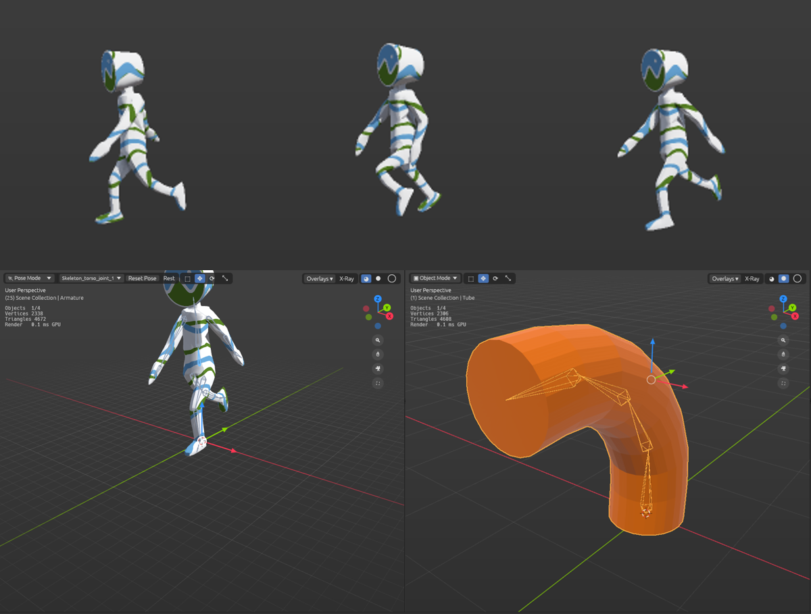

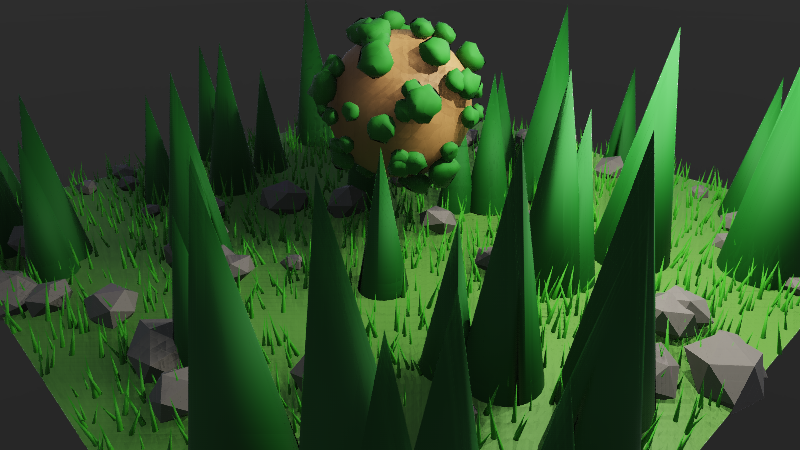

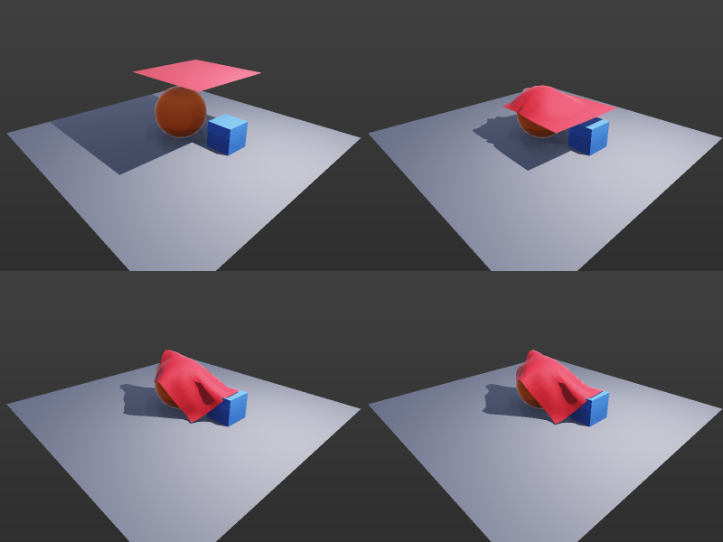

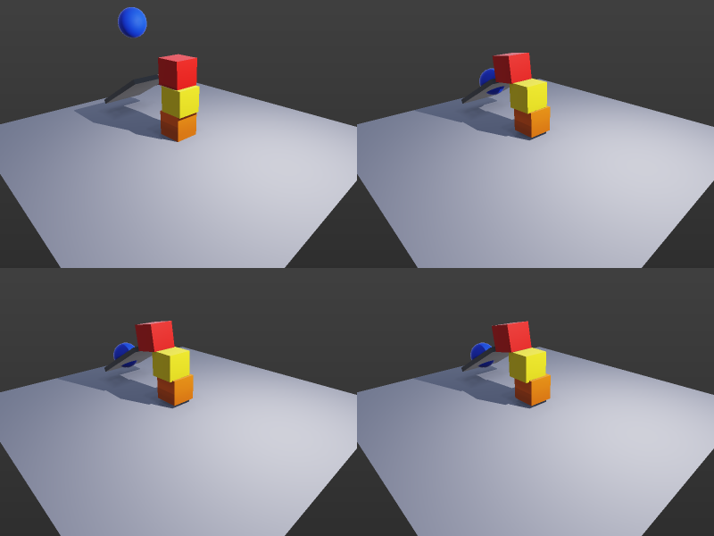

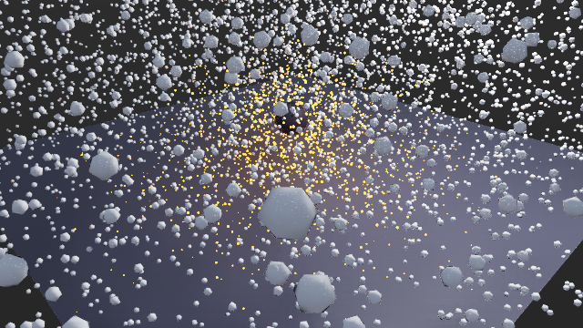

## Features

| Area | What you get |
|---|---|
| **Viewport** | A **GPU renderer** (wgpu) with 4× MSAA, a real depth buffer and selection outlines drawn in a shader. Picking is pixel-exact from an ID buffer that is read back asynchronously. A multithreaded **software renderer** takes over automatically if the GPU path isn't available, and you can toggle it under *Overlays*. Shading modes are Wireframe, Solid (studio light) and Material Preview (scene lights, Fresnel, metallic and roughness). Also X-ray, a fading grid, a 3D cursor and a clickable navigation gizmo. |
| **Object mode** | Cube, plane, UV/ico sphere, cylinder, cone, torus and a "blob" head. Modal **G / R / S** transforms like Blender, with X/Y/Z axis locks, typed numbers and Ctrl to snap. Move, Rotate and Scale gizmos, box select, duplicate, hide/reveal, unlimited undo, and Array, Mirror, Radial-Array and **Subdivision Surface** (Catmull–Clark, **Alt+1/2/3**) modifiers. **Shade Smooth / Auto Smooth** (by angle) keeps hard edges crisp on smooth-shaded, beveled and imported models. |
| **Booleans** | **Difference, Union and Intersect** (Object ▸ Boolean, or the AI's `boolean` command) cut windows, doors and holes, or merge shapes. They use exact BSP CSG on the real geometry, including modifiers. The cutter is hidden afterwards in a "Cutters" collection so you can reuse it, and each boolean is one undo step. Ask "cut a round window in the wall". |
| **Hierarchy** | **Parenting** (Ctrl+P / Alt+P, or `parent` in AI commands): children follow their parent when it moves, rotates or scales, whether you grab it, the AI moves it or animation plays. **Collections** (M) appear as folders in the outliner, with a tree view and a show/hide toggle per collection. Imported glTF files keep their node hierarchy and land in a collection named after the file. Export writes the hierarchy back to glTF. |
| **Edit mode** (Tab) | Polygon (n-gon) meshes with **vertex / edge / face** selection (1 / 2 / 3), box select and G/R/S on components. **Extrude** (E, constrained to the face normal), **Inset** (I), **Bevel** (Ctrl+B: mouse sets the width, wheel the segments, with round profiles and spherical corners), **Loop Cut** (Ctrl+R, wheel or +/- sets the cut count) with a live preview, **Knife** (K: click a path across the mesh, snapping to vertices and edges; Enter cuts, Backspace removes a point), **Subdivide**, **Merge** (M), **Delete** (X) and **Flip Normals** (Alt+N). **Proportional editing** (O): G/R/S pulls nearby vertices along with a smooth falloff, and the wheel changes the radius. The AI can bevel too ("round the edges of the cube"). |
| **Sculpt mode** (Ctrl+Tab) | **Draw, Inflate, Smooth, Grab, Crease and Flatten** brushes with X-mirror symmetry and a radius/strength cursor. Hold Shift to smooth and Ctrl to invert; [ ] changes the radius and Shift+[ ] the strength. Coarse meshes are refined automatically when you enter sculpt mode (Catmull–Clark for smooth shapes). **Dyntopo** (header toggle) adds triangles only where the brush works, with a detail size relative to the brush, so you can start from a cube and sculpt fine features. Each stroke is one undo step. |
| **Scatter** (geometry-nodes lite) | Spread copies of an object over a surface: Object ▸ Scatter (rocks, trees, grass, bushes, flowers, or any selected object), or "add a forest on the ground". Count, seed, random scale / spin / tilt, a slope limit and normal alignment (for planets) are live in the properties panel; the hidden source object is the template, so editing it changes every copy, and moving the surface carries them along. Make Real bakes it. |
| **Hair & fur** | Object ▸ Hair (Fur, Hair, Curly Hair, Shaggy Fur, Grass Strands), or "give the ball fur" / "long hair on the head". Strands are thin tapered tubes grown from the surface: guide strands plus children around them, length and random length, gravity droop, clumping, curl turns and radius, frizz, thickness, tip width and segments — all live in the properties panel. Roots stay on their faces, so hair follows the surface when it moves, is skinned, shape-keyed or edited. UVs run root → tip, so the Hair Strands node material (made automatically) darkens the roots; an untouched surface is tinted to the root colour so it doesn't show through. **Hair Edit** mode (mode menu, or Groom in the Hair panel) grooms the guide strands with brushes: Comb (drag to lay hair over), Length (Ctrl shortens), Puff (Ctrl flattens), Cut and Smooth, with the guides drawn on top. **Dynamics**: tick it and Simulate — strands lag, swing and settle as the surface moves through its animation (stiffness and damping in the panel; "simulate the hair" works too). Renders in every engine and exports to glTF as geometry; Make Real bakes it. |
| **Character kit** | Add ▸ Character (or the Character template, the asset library, or "add a person waving"): a stylised 1.8 m mannequin — one smooth mesh with a named humanoid rig (hips, spine, chest, neck, head, arms, hands, legs, feet), clean per-limb skin weights and five ready actions: **Idle, Walk, Run, Wave, Jump** (Actions panel or `play_action`). "Character with Hair" adds a scalp with combed long hair that follows the head (hair dynamics work on it). Everything is ordinary rig/mesh data: pose it, edit the bones, paint weights, key your own actions. |
| **Grease Pencil** | Draw mode (mode menu, or Add ▸ Grease Pencil drawing): freehand strokes and straight lines in 3D — on a plane facing you through the 3D cursor or stuck to surfaces — with a colour palette, thickness and opacity, and an eraser that splits strokes. **Frame by frame** gives each frame its own drawing for 2D animation, with **onion skinning**. Strokes are drawn flat on top like Blender's Grease Pencil, in the viewport and in F12 / path-traced / animation renders. The AI draws too: "draw an arrow to the cube", "circle the tree in red". |
| **Templates** | A start screen (File ▸ Start Screen…, or at launch) with ready-made scenes: General, Empty, **Product Shot** (seamless studio backdrop, three-point lighting, a ceramic vase), **Turntable** (spins 360° over 120 frames — render it to MP4), **Landscape** (hills, trees, rocks, low sun), **Interior** (wooden floor boards, a table, a lamp, sunlight), **Physics Playground** (dominoes, a tower and a ball, already simulated) and **Hair & Fur** — plus recent files. File ▸ New from Template, or ask "start a product shot". Everything in a template is ordinary, editable objects. |
| **Asset Library** | Add ▸ Asset Library… (Shift+F1): built-in objects (vase, rock, pine tree, bush, flower, table, chair, furry ball, domino, lamp) and materials (gold, chrome, copper, glass, plastic, rubber, ceramic, neon, and the shader-node presets), with path-traced thumbnails. Click to place at the 3D cursor or apply to the selection, or **drag into the viewport** — objects land on the surface under the pointer, materials go on the object you drop them on. **Save Selected** keeps any objects (with their children, materials, node graphs, textures, hair, rigs) or the active material in your own library (`.rbasset` files) for every project. The AI can use it too: "put a lamp next to the table", "make the cube chrome", "save this as an asset". |
| **Armatures & Pose Mode** | **Auto Rig** (Object ▸ Rig, or "rig the snake with 6 bones") fits a bone chain along a mesh and binds it with **automatic weights**; or add an armature (Add ▸ Armature) and parent meshes to it with Ctrl+P. **Pose Mode** (Ctrl+Tab on an armature): click a bone, **R** rotate, **G** move, Alt+R / Alt+G clear, **I** keyframe the pose; bone rotations are also editable in the properties panel, and the AI can `pose_bone`. Meshes deform with linear-blend skinning (subdivision is applied after the deformation) in every view and render. **Edit Mode** on an armature (Tab): click a bone, its head or its tail; **G** move (connected bones follow), **E** extrude a new bone, **Shift+A** add one at the 3D cursor, **X** delete; bound meshes keep their shape. **Inverse kinematics**: Shift+I in Pose Mode (or "add IK to the hand") makes the bone's tip reach for an Empty target; move the target (G on the bone, or the Empty itself) and the chain bends to follow, with an adjustable chain length. Keyframing the target animates the limb. **Weight Paint** (Ctrl+Tab on a rigged mesh) shows the active bone's influence as a blue→red heatmap; paint with Add / Subtract (Ctrl) / Blur (Shift), Alt+click a bone to switch. |
| **Animation import** | glTF **skins** become armatures with bound meshes, and **animations** are baked to keyframes (bones and objects; LINEAR, STEP and CUBICSPLINE), so Khronos samples like CesiumMan, Fox and RiggedFigure walk when you press play. Every animation becomes an **Action** (Fox has Survey, Walk and Run): pick one in the armature's properties or say "play the run animation" (switching cross-fades from the current pose over a few frames); New Action starts another. All actions export back to glTF. |
| **Shape keys** | Blend alternative shapes of a mesh (facial expressions, squash and stretch) with sliders in the Object panel. **+ Add Shape Key** copies the current shape and opens it in edit mode; edit or sculpt it and leave the mode to store it (✎ edits an existing key). ◆ keyframes a value, so shapes animate; they also work on rigged meshes, before the skinning. glTF **morph targets** import and export (names, weights and weight animation), so the Khronos AnimatedMorphCube animates. Ask the AI "add a squash shape key and animate it". |
| **Cloth** | Object ▸ Physics in the properties: a sheet drapes over the other meshes (spheres collide as spheres, everything else as boxes, planes as floors), pinned at nothing, its top, its corners or an edge (flags). Stiffness, bending, air and gravity; Bake simulates the timeline range (position-based dynamics), then it plays back like animation (simulations are re-run automatically when you open a file). Say "drop a tablecloth on the table". |
| **Rigid bodies** | Rigid Body in the Object panel (Active / Passive) or "make the crates fall": objects fall, tumble, bounce and stack on the other meshes. Each body is a cluster of particles held rigid by shape matching, with friction and bounce; spheres roll as spheres. Simulated over the timeline and played back like animation (Bake after moving things). |
| **Particles** | Add ▸ Particles: sparks, snow, rain, confetti, bubbles, smoke or fire, from the active object or (weather) from an emitter above the scene; or "make sparks fly from the sphere". Rate, life, speed, spread, gravity, drag, size, shrink and collisions are in the panel; the hidden source object is the particle's look (any mesh works). Weather is pre-simulated so it is already falling at frame 1. |
| **Lights & cameras** | Point, Sun and Spot lights that light the Material Preview, and camera objects. **Numpad 0** looks through the camera, with a passepartout around the frame; **Ctrl+Alt+0** aligns the camera to the view. A "look at" command aims lights and cameras. The default scene is Blender's: a cube, a light and a camera. |
| **Animation** | Keyframes with eased interpolation, a timeline, auto-keying and playback. |
| **AI Copilot** | **Streams** replies from Ollama: the text appears live, and each command is applied the moment it finishes generating. There's a Stop button, and the whole answer is a single undo step. Simple commands run instantly without the LLM. The app auto-picks the best installed model and can download models from inside the app. The AI can also edit meshes (select faces, extrude, inset, loop cut and so on). |
| **Picture to scene** | Attach a photo or sketch (📎, or drop it on the Copilot panel) and say what you want, or just press Enter. A local **vision model** (`qwen2.5vl:7b` recommended; gemma3 and llama3.2-vision also work) describes the objects, sizes, colours and layout, and the builder model recreates it. MCP agents can pass `image_path` to `ask_copilot`. |
| **Voice** | Local Whisper (tiny, base, small or distil) with hands-free auto-stop and a level meter. Spoken requests go through tev1 for sub-second edits, and the app **says what it did** ("Added a red cube"). **Conversation mode** reopens the mic after each reply, an optional **wake word** ("Blender, …") listens in the background, and you can say "no, undo that", "stop", "repeat that" or "that's all" at any time. |
| **Render (F12)** | Renders a final image through the scene camera: shadows from every light are ray-traced against the real geometry, plus ambient occlusion, ACES filmic tone mapping and 2×2 supersampled anti-aliasing. Choose 720p, 1080p, 4K or square, optionally with a transparent background, then save as PNG. You can trigger it by voice or the AI ("render it") or over MCP. |
| **Path tracing** | A second F12 engine (*Path traced*, in the Render window) gives bounced light, soft shadows, glossy GGX reflections, glass (any material with alpha < 1 refracts), emissive surfaces and textures. It refines progressively on every CPU core, with a progress bar, a time-left estimate and Stop. A binned-SAH BVH makes it about 2.5× faster than the first version. A built-in **denoiser** (edge-aware à-trous, guided by albedo and normals traced *through* mirrors and glass) turns 16–32 samples into a clean image. Choose the sample count, say "render it path traced", or call MCP `render_image` with `engine: "path"`. |
| **Textures & UVs** | Image textures (PNG/JPEG) and 10 tileable **procedural** ones (checker, bricks, wood, marble, tiles, grid, noise, stripes, concrete, grass). They show in Material Preview (GPU texture atlas or the software renderer, perspective-correct) and in F12 renders. Meshes keep per-corner UVs from imported files; anything else gets automatic box-projection UVs, with a Repeats slider. **UV unwrapping** (U in edit mode, the Mesh or Object menu, or the AI's `unwrap`) offers **Smart UV Project** (charts grouped by angle and packed into 0–1), Cube, Sphere and Cylinder projection. The **UV Editor** window shows the layout over the texture, lets you drag and scale UVs, and only changes the selected faces in edit mode. Textures are saved inside the `.rblend` file. Ask the AI "make the floor wood", or say "give it a brick texture". |
| **Normal & roughness maps** | Full PBR texture sets: a **normal map** (tangent space, glTF/OpenGL convention, with a Strength slider) and a **roughness/metallic map** (glTF layout; a grey image works as a roughness map). glTF imports and exports them (`normalTexture`, `metallicRoughnessTexture`), so models like the Khronos DamagedHelmet render with their real detail. No map? **Bumps from texture** generates one from the colour texture (procedural patterns know their grooves: mortar, grout, wood grain), and **Roughness from texture** makes the grooves matte. The path tracer shades every pixel with them; Material Preview and Fast renders bake the bump shading into the texture. In the Material tab under Surface Detail, or ask the AI "make the bricks bumpy". |
| **Shader nodes** | Material ▸ Nodes: **Use Nodes** or a preset (Rusty Metal, Wood, Marble, Cobblestone, Lava, Bricks, Tiles, Granite), then **Edit Nodes…** opens the Shader Editor: Texture Coordinate (**UV or Object** — Object coordinates are a solid 3D texture with no UV seams, so low-poly or unwrapped meshes look right), Image, Noise, Voronoi, Checker, Brick, Wave and **Gradient** (linear / radial / spherical) textures, Color Ramp, Mix Color (mix / multiply / add / overlay), **Hue/Saturation**, Math, Invert, **Normal Map**, RGB and Value nodes feeding a Material Output (colour, roughness, metallic, emission, bump height, normal). Drag from an output dot to an input to connect, drag headers to move, right-click to add, Del removes, Arrange lays them out. The Material tab's preview ball shows the real graph result (colour, roughness, metal, emission, bumps). The path tracer evaluates the graph per pixel (bump and normal mapping); Material Preview bakes to textures — Object-coordinate graphs bake at each texel's 3D point over the mesh's own UVs (per vertex when it has none) and F12 evaluates them exactly; glTF export uses the UV bakes (colour, roughness/metal, normal map; Object-coordinate graphs export a planar slice). Ask the AI "make the floor cobblestone" or "make it rusty". |
| **Render animation** | Render ▸ Render Animation (Ctrl+F12), the 🎞 button in the Render window, or "render the animation": every frame of the timeline with either engine, written as `frame_0001.png …` into `<file>_render` next to your .rblend (or a folder you pick), in the background with progress and Cancel. With **ffmpeg** on the PATH it also writes an H.264 **MP4**. Agents can call the `render_animation` MCP tool. |
| **Files** | Save and open `.rblend`. **Autosave** runs every 2 minutes, and after a crash the app offers to recover your work. **Import glTF 2.0** (`.glb`, or `.gltf` with embedded or external buffers and images): meshes with UVs, PBR materials with base-colour, normal and metallic-roughness textures, lights, cameras, skins and animation, with triangles merged back into quads. You can also drag files onto the window: `.glb`/`.gltf` import, images become a texture on the selection, `.rblend` opens. **Export glTF 2.0 (.glb)** with meshes (modifiers applied), UVs and textures, PBR materials, emissive strength, lights (`KHR_lights_punctual`), cameras, baked animation, **shader-node materials** (baked to textures), **cloth** (morph targets with a frame-by-frame weight animation), **particles** (one animated node per particle), **rigid bodies** (as keyframes) and **rigs** (armatures as joint hierarchies, skin weights and bone animation, so a rigged character round-trips through Blender or any glTF viewer); the output passes the Khronos glTF-Validator with 0 errors and 0 warnings. Also exports Wavefront `.obj`. |

## Recommended Ollama model

The default is **`qwen3:8b`**. Qwen3 follows JSON-schema "structured outputs" and tool-style instructions reliably and is good at the spatial arithmetic that scene building needs (for example, "a ring of 12 cubes"). The 8B model runs comfortably on a GPU with about 6–8 GB of VRAM.

| Your hardware | Model |
|---|---|
| 8 GB+ GPU (recommended) | `qwen3:8b` |
| Low VRAM / CPU only | `qwen3:4b` |
| 16 GB+ GPU, best quality | `qwen3:14b` |

The app ranks whatever you have installed and picks the best fit: qwen3 first, then qwen2.5, llama3.1, mistral-nemo, gemma3 and so on. You can always override the choice in **Copilot ⚙ → Model**.

## Two-model AI: decision model + builder

Install a small tool-calling **decision model** (for example `tev1`) alongside qwen3. The app picks up anything named `tev1` automatically; to choose one yourself, use Copilot ⚙ → **Decision**. Every request then goes through two stages:

1. The **decision model** reads the request plus the scene and picks one of Ollama's tools:
   * `scene_command` handles simple edits ("put a small blue ball on the cube") **itself**, usually in well under a second;
   * `answer` replies to questions ("how do I extrude?") without touching the scene;
   * `delegate_to_builder` hands creative, multi-object builds to the builder model, together with a short plan.
2. When the request is delegated, the **builder model** (qwen3) streams the full build and uses the plan as guidance.

The chat shows who handled each request ("handled by tev1 · direct" or "tev1 → qwen3:8b · plan: …"). If the decision model doesn't support Ollama tools, the app falls back to JSON output with the same routes. If the decision model fails, qwen handles the request. Simple commands like "undo" or "top view" still skip both models.

### Agent loop: plan → act → check

After any AI build, Rust Blender **checks the result** itself, using the real mesh geometry rather than the model's guess:

* objects **floating** above whatever is below them, or **sunk** into the ground;
* objects **hidden** completely inside another object (tested point by point against the actual mesh, so a scarf around a neck isn't flagged, but a nose buried inside a head is);
* exact **duplicates**, and **failed commands**.

Only objects the build touched are checked. The flagged issues and the scene's bounding boxes go to the **reviewer**: the decision model if you have one, otherwise the builder. The reviewer decides which problems are real (a ring meant to hover stays put) and sends fixes. The check runs again, up to 2 rounds. The build and all its fixes form **one undo step**. You can turn the loop off with Copilot ⚙ → "Check & fix AI builds".

## MCP server: let other AI agents drive it

Rust Blender runs a **Model Context Protocol** server, so external agents such as Claude Desktop, Claude Code, Cursor or VS Code can build in the live scene. It starts with the app and listens only on `127.0.0.1:7878` (change the port or turn it off in Copilot ⚙ → **MCP**). Every call shows up in the Copilot chat, and each `run_commands` call is one undo step.

| Tool | What it does |
|---|---|
| `run_commands` | Runs a batch of editor commands (the same JSON commands the Copilot uses) and returns a per-command log |
| `get_scene` | Lists objects with type, transform and world bounding boxes, plus the selection, frame and mode |
| `check_scene` | Runs the agent-loop geometry checks (floating, sunken, hidden, duplicates) on the whole scene |
| `ask_copilot` | Hands a plain-English request to the app's own Ollama Copilot |
| `render_image` | Renders through the camera and returns the PNG as an image, so the agent can see its work (optionally also saves it) |
| `import_gltf` | Imports a `.glb`/`.gltf` file |
| `export_gltf` | Writes the scene to a `.glb` file |

**Claude Code** (HTTP):

```powershell
claude mcp add --transport http rust-blender http://127.0.0.1:7878/mcp
```

**Claude Desktop / Cursor** (stdio): click **Copy client config** in Copilot ⚙ and paste it into `%APPDATA%\Claude\claude_desktop_config.json` (Cursor: `.cursor\mcp.json`). It looks like this:

```json
{ "mcpServers": { "rust-blender": {
    "command": "C:\\Users\\you\\Rust_Blender\\target\\release\\rust_blender.exe",
    "args": ["--mcp-stdio"] } } }
```

`rust_blender --mcp-stdio` is a small bridge that forwards to the running app and starts the app if it isn't open. Requests from web pages on other origins are refused.

## Setup (Windows)

1. Install **Rust**: <https://rustup.rs>. You also need the *MSVC C++ Build Tools*; rustup offers to install them.
2. Install **Ollama**: <https://ollama.com/download>, then run:
   ```powershell
   ollama pull qwen3:8b
   ```
3. Build and run (use `--release`, because the software renderer and Whisper are much faster that way):
   ```powershell
   cd Rust_Blender
   cargo run --release
   ```
   Or double-click `run.bat`.

The first time you click the 🎤 mic, the Whisper model is downloaded once from Hugging Face (about 145 MB for `base.en`). It is cached in `%LOCALAPPDATA%\rust_blender\whisper\<model>`. If that download is blocked on your network, put `config.json`, `tokenizer.json` and `model.safetensors` from `huggingface.co/openai/whisper-base.en` into that folder yourself.

To build without voice support (smaller and faster to compile), run `cargo run --release --no-default-features`.

## Talking to it

Click the mic (or press **Ctrl+Space** or the **`** key), speak, and pause. Examples:

* "add a blue sphere", "move it up two", "rotate ninety degrees on x", "make it bigger", "top view", "undo". These go through the instant command parser.
* "extrude the top of the cube by two", "add a loop cut around the middle", "inset the top face" use edit mode.
* "add a spotlight pointing at the cube", "look through the camera".
* "build a snowman", "make a solar system with orbiting planets", "create a table with four legs", "put a ring of 8 glowing cubes around the torus", "animate the cube spinning 360 degrees over 60 frames". These go to the LLM.

Follow-ups work because the AI sees the current scene and the conversation history: "make the second one red", "now hide the hat".

### Hands-free

* After a voice request the app speaks a one-line confirmation, then (with **Conversation** on) listens again. Stay silent for about 7 seconds, or say "that's all", to stop.
* Turn on **Wake word** in Copilot ⚙ to talk without clicking: "Blender, add a torus", or just "Blender…" and it answers "Yes?". Listening stays on your computer.
* Say "stop" to cancel a running build, "no, undo that" to revert, or "what did you do?" to hear the last confirmation again. Clicking the mic while it talks interrupts it.
* Common mishearings are fixed before the request is sent ("queue" → cube, "Taurus" → torus, "in set" → inset), and the decision model is told the text came from speech.

## Keyboard (Blender-compatible)

| Keys | Action |
|---|---|
| LMB / Shift+LMB / drag | select / extend / box select |
| MMB (Alt+LMB), Shift+MMB, wheel | orbit, pan, zoom |
| G R S then X/Y/Z, digits, Ctrl | grab / rotate / scale, constrain, exact value, snap |
| Shift+A, Shift+D, X, H / Alt+H | add, duplicate, delete, hide / reveal |
| 1 3 7 (Ctrl), 5, F, Home | views, ortho toggle, frame selected / all |
| Z, Alt+Z, W | cycle shading, X-ray, cycle tool |
| I, Space, ← → | keyframe, play, step |
| F3 / Ctrl+K | command search (falls back to the AI) |
| / or Ctrl+L, N | focus the AI prompt, toggle the Copilot panel |
| Ctrl+Z / Ctrl+Shift+Z, Ctrl+S / O / N | undo / redo, save / open / new |
| Tab | edit mode on the active mesh; on an armature: bone edit mode (G move, E extrude, Shift+A add, X delete) |
| Ctrl+P / Alt+P, M | parent to active / clear parent, move to collection |
| Alt+1/2/3, Alt+0 | Subdivision Surface level, remove it |
| 1 / 2 / 3 (edit) | vertex / edge / face select |
| E, I, Ctrl+B, Ctrl+R, K (edit) | extrude, inset, bevel, loop cut, knife |
| O (edit) | proportional editing (wheel = radius) |
| M, X, Alt+N (edit) | merge, delete, flip normals |
| Ctrl+Tab | sculpt mode (X/I/S/G/C/T brushes, [ ] radius); on an armature: pose mode (R/G bones, Alt+R/Alt+G clear, I key); on a rigged mesh: weight paint |
| Numpad 0, Ctrl+Alt+0 | look through the camera, align the camera to the view |
| F12 / F11 | render image / show the last render |

## Architecture

```
src/
  main.rs      eframe bootstrap
  app.rs       layout, menus, Copilot chat, voice UX, outliner, properties, timeline, palette
  viewport.rs  camera, scene → primitives, navigation, modal transforms, gizmos, HUD
  viewport/edit.rs  edit-mode drawing, component picking, extrude / inset / loop-cut tools
  raytrace.rs  triangle BVH (closest hit + shadow rays)
  pathtrace.rs progressive path tracer (GI, GGX, glass, NEE, textures)
  gpu.rs       wgpu renderer: MSAA colour pass, ID/depth pass + async readback, outline composite
  render.rs    multithreaded software z-buffer rasterizer (fallback), ID buffer, selection outline
  sculpt.rs    sculpt brushes (draw, inflate, smooth, grab, crease, flatten)
  armature.rs  bones, poses, bone keys, automatic weights, linear-blend skinning
               (viewport/pose.rs draws bones and handles Pose Mode)
  csg.rs       BSP mesh booleans (union / difference / intersect)
  editmesh.rs  mesh operators (extrude, inset, loop cut, knife, subdivide, merge, delete …)
  gltf.rs      glTF 2.0 / .glb exporter
  gltf_import.rs  glTF 2.0 importer (.glb / .gltf, data URIs, external files), quad merging
  uv.rs        UV unwrapping (smart project + packing, cube / sphere / cylinder)
               (normal maps: textures.rs generates/bakes them; pathtrace.rs shades with them)
  textures.rs  image + procedural textures, decoding, sampling, cache
  editor.rs    editor state, undo, and the command executor shared by UI / AI / voice
  mcp.rs       MCP server (Streamable HTTP on 127.0.0.1) + --mcp-stdio bridge
  ai.rs        Ollama client, model ranking, JSON schema + system prompt, offline parser
  voiceflow.rs wake word, voice intents, mishearing fixes, spoken confirmations, interruptible TTS
  voice.rs     cpal mic capture, VAD, resampling, candle Whisper + tiny BPE decoder
  scene.rs     objects, transforms, materials, modifiers, keyframes, OBJ export
  mesh.rs      PolyMesh (n-gons) + render mesh, ear-clipping triangulation, procedural primitives
  theme.rs     Blender-like dark theme
```

The AI never touches the scene directly. It produces a list of flat `Command` records, for example `{"action":"add","primitive":"cone","location":[0,0,2],"color":"orange"}`, which `Editor::execute` validates and applies. That keeps the AI's actions safe, undoable and visible in the chat log.

Run the tests with `cargo test`. `rust_blender --export-demo out.glb` builds a demo scene from `docs/demo_scene.json` without opening a window and exports it, which is handy for checking the glTF exporter.
